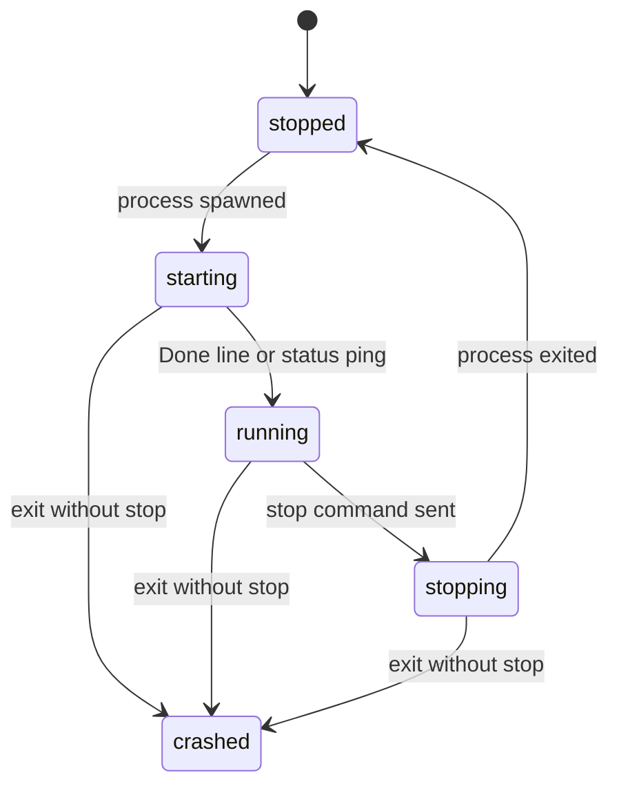
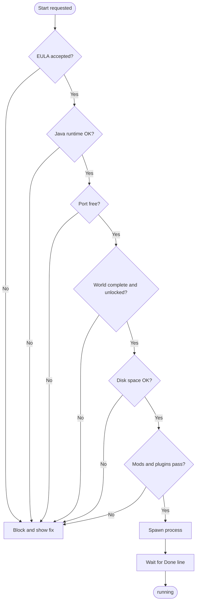
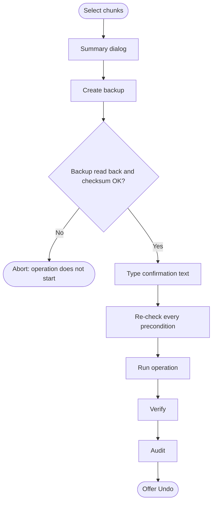

# 🧱 Chunkly

   

> **A local-first, open-source manager for Minecraft Java Edition servers: live console, players and inventories, granular permissions, an interactive world map and a mod manager. No cloud, no subscription.**

<picture>
  <source media="(prefers-color-scheme: dark)" srcset="https://github.com/user-attachments/assets/dae25d8f-49bc-4e59-a1c4-3acdcbb6c654">
  
</picture>

---

## Table of Contents

- [Overview](#overview)
- [Installation](#installation)
- [Architecture](#architecture)
- [Supported Server Software](#supported-server-software)
- [Features](#features)
- [Security](#security)
- [Configuration](#configuration)
- [Dependencies](#dependencies)
- [Repository Layout](#repository-layout)
- [Contributing](#contributing)
- [License](#license)

---

## Overview

The owner installs Chunkly on the computer that runs the servers. A background daemon, **`chunklyd`**, does all the real work: it spawns server processes, reads their output, edits real files and enforces every permission. The panel is only a window onto the daemon.

Two rules drive the whole design:

```
state changes  → only on a real event (process, console line, exit code)
success        → only after the authoritative mechanism confirmed it
```

### Principles

| # | Principle | Meaning |
| - | --------- | ------- |
| 1 | **Local first** | Works with no connection to any Chunkly-operated service. There is no Chunkly cloud. |
| 2 | **Real management** | Controls real processes and real files. It is not a mock-up. |
| 3 | **Least privilege** | Nobody gets a permission the owner did not grant, or can grant more than they hold. |
| 4 | **Backend authority** | The daemon enforces every permission. The UI only hides controls for convenience. |
| 5 | **Honest limits** | Free services have limits, direct connections can fail, some versions lack features. Chunkly says so. |
| 6 | **Modular** | Game-specific behavior lives in adapters. |
| 7 | **Privacy by design** | Only data a feature needs is collected. Optional collection is off by default. |

### Roles

| Role | Description |
| ---- | ----------- |
| **Owner** | Installed Chunkly and controls the data directory. Holds every permission, cannot be removed or demoted. |
| **Administrator** | Broad set of permissions granted by the Owner |
| **Member** | Has an account (local or OAuth) and a limited set of permissions |
| **Visitor** | Entered through an invite link with a nickname, no account |
| **Player** | A Minecraft player. Not automatically a Chunkly user. |

> [!NOTE]
> Roles are only presets. Authorization is always computed from the explicit permission list.

### Honesty rules

- The UI shows **real state only**. It never simulates a server, player, position, inventory or test result.
- A Minecraft version, loader or platform is never called supported without a `validated` entry and a test report.
- If a value is unavailable, the UI shows that it is unavailable and why.
- Secrets never go in the repository, logs, error messages or URLs.

---

## Installation

Chunkly is a graphical app on every platform. After installing, the owner never needs a terminal.

| Platform | Package | Notes |
| -------- | ------- | ----- |
| **Windows** | Graphical `.exe` installer | Per-user, no administrator rights. Start menu shortcut and uninstall entry. |
| **macOS** | `.dmg` | Drag into Applications. Separate images for Apple silicon (arm64) and Intel (x64). |
| **Linux** | Terminal installer, **or** AppImage / `.deb` | The installer is the only terminal-based install in the product. |
| **Android** | Signed APK on the release page | Panel client only. Android does not host Minecraft servers. |
| **iOS** | None | Out of scope for the MVP. |
| **Browser** | Panel served by the daemon | Local by default, remote when the owner enables it. |

Every release page lists the **SHA-256 checksum** of each file.

> [!CAUTION]
> The MVP ships **unsigned builds**, because signing certificates are paid services. Each system shows a one-time warning:
> - **Windows SmartScreen:** *More info*, then *Run anyway*
> - **macOS Gatekeeper:** right-click the app, then *Open*
>
> Verify the file against the published checksum first.

<details>
<summary><b>Linux terminal installer</b></summary>

One self-contained executable (no Node.js needed). It never uses `sudo` and never asks for the root password.

| Step | Action |
| ---- | ------ |
| 1 | Checks distribution, architecture and free disk space |
| 2 | Asks where to install (default `~/.local/share/chunkly`) |
| 3 | Installs the daemon and desktop app for the current user only |
| 4 | Creates the desktop menu entry |
| 5 | Asks whether to start at login (default **Yes**, via a systemd user unit) |
| 6 | Prints how to open and uninstall Chunkly |

</details>

### First run

Nothing is created on disk until you confirm the final summary.

1. **Data directory:** pick a writable folder. Chunkly creates a hidden `.chunkly/` inside it.
2. **Owner account:** create a local username and password.
3. **Security defaults:** the panel listens on `127.0.0.1` only, remote access is off.
4. **First Instance** (skippable): create a new one or import an existing server folder.
5. **Summary and confirmation.**

---

## Architecture

```
┌──────────────────┐         ┌──────────────────┐
│   Desktop app    │         │   Android app    │
│ (Electron shell) │         │ (Capacitor shell)│
└────────┬─────────┘         └────────┬─────────┘
         │ loopback (owner)           │ internet (guest / owner remote)
         ▼                            ▼
┌──────────────────────────────────────────────────┐
│                chunklyd (daemon)                 │
│  API (HTTP + WebSocket) · Auth · Authorization   │
│  Instance supervisor · Adapters · Scheduler      │
│  Storage (SQLite + files) · Audit · Connectivity │
└────────┬───────────────────────────┬─────────────┘
         │ stdin/stdout, RCON        │ files
         ▼                           ▼
 Minecraft server processes     .chunkly/ directory
 (+ optional Chunkly Bridge)
```

- **Daemon:** a separate process. Closing the panel never stops it or its monitoring.
- **Panel:** one React app, served by the daemon and embedded in both Electron and Capacitor.
- **Chunkly Bridge** (optional): a small Java mod/plugin, installed only after consent, for tasks the console cannot do safely. Chunkly works in a reduced mode without it and says what it disables.

<details>
<summary><b>Storage layout</b></summary>

```
<data-dir>/.chunkly/
├── chunkly.db            SQLite (accounts, permissions, audit, settings)
├── config/daemon.json    daemon settings (no secrets)
├── secrets/              encrypted key store (OS keychain preferred)
├── shared-files/         area for the Danger Zone file tools
└── instances/<instanceId>/
    ├── instance.json     Instance settings
    ├── server/           jar, server.properties, mods/, plugins/, config/
    ├── worlds/<worldId>/ Chunkly-managed world copies
    ├── backups/          chunk, world and player-data backups
    ├── trails/           position history (only if enabled)
    ├── logs/             console and audit logs
    └── cache/            map tiles, item catalog, icons
```

</details>

<details>
<summary><b>API conventions</b></summary>

- REST JSON under `/api/v1/...` and a WebSocket at `/api/v1/ws`.
- Every input is validated with `zod`. Unknown fields are rejected.
- IDs are ULIDs, timestamps are UTC ISO 8601, lists use cursor pagination.
- Destructive endpoints need an `Idempotency-Key` and a typed confirmation the daemon verifies itself.
- Every route declares its permission. A startup check fails the build otherwise.

```json
{ "error": { "code": "PERMISSION_DENIED", "message": "...", "details": {}, "requestId": "..." } }
```

</details>

<details>
<summary><b>Adapter interface</b></summary>

```ts
interface GameAdapter {
  id: 'minecraft-java';
  detect(dir: string): Promise<DetectionResult>;
  capabilities(instance: Instance): Capabilities; // per instance, per version
  start(i: Instance): Promise<void>;
  stop(i: Instance, opts: { graceMs: number }): Promise<void>;
  sendCommand(i: Instance, cmd: SafeCommand): Promise<CommandResult>;
  listPlayers(i: Instance): Promise<PlayerSummary[]>;
  // optional, present only if capabilities say so:
  getInventory?(i: Instance, player: PlayerId): Promise<Inventory>;
  editInventory?(i: Instance, player: PlayerId, ops: InventoryOp[]): Promise<EditResult>;
  worlds?: WorldOps;
  mods?: ModOps;
  map?: MapOps;
}
```

</details>

> [!TIP]
> A control for an unsupported feature is shown **disabled with the reason**, never hidden. Commands are structured objects (`SafeCommand`), never raw client strings, which prevents command injection.

---

## Supported Server Software

| Type | What it is | Plugins | Mods | Notes |
| ---- | ---------- | :-----: | :--: | ----- |
| **Vanilla** | Official Mojang server | No | No | Simplest. Commands and files only. |
| **Paper** | Faster server that accepts plugins | Yes | No | Best fit for permission plugins and Geyser |
| **Fabric** | Lightweight mod loader | No | Yes | Item catalog needs the Bridge |
| **Forge** | Older, large mod loader | No | Yes | Different mod format from Fabric |
| **NeoForge** | Newer fork of Forge | No | Yes | Not interchangeable with Forge mods |

The target range is **Minecraft 1.16 up to the newest release**. A Spigot jar is not a separate target.

> [!WARNING]
> A goal is not proof. A version is shown as supported only when `compat/matrix.json` says so. Chunkly never offers a mod install on Paper or a plugin install on a loader.

### Compatibility matrix

| Status | Meaning |
| ------ | ------- |
| `validated` | Every listed feature passed its end-to-end test (test report mandatory) |
| `partial` | Some features passed. The rest are listed and disabled. |
| `unsupported` | Known not to work. Creating or importing it is refused, with the reason. |
| `untested` | Runs as a plain server. Every advanced feature is disabled and labeled. |

**MVP release gate**, tested with real servers and real clients:

1. The newest stable Minecraft release on Vanilla, Paper, Fabric, Forge and NeoForge, wherever a build exists
2. 1.21.1 (or the newest 1.21.x all five support) and 1.20.1 on every software that has a build
3. 1.16.5 on Vanilla, Paper, Fabric and Forge

<details>
<summary><b>Detection, Java and downloads</b></summary>

- **Detection** never executes the jar. It reads the embedded version file, loader launch files and `server.properties`. If ambiguous, the owner chooses and the Instance stays *unverified* until the first successful start.
- **Java** requirements come from Mojang's version metadata. Chunkly never installs Java silently.
- **Downloads** use HTTPS from official sources (Mojang manifest, PaperMC API, each loader's installer), streamed to a temp file and checksum-verified.
- **EULA:** the server will not run until the owner ticks an unchecked box. Only then is `eula=true` written, and it is audited.

</details>

---

## Features

Everything below is included in Chunkly.

### Instances & Console

Create or import an Instance, watch its console, start and stop it. One daemon manages many Instances at once, each with independent settings, ports, worlds, mods, backups, logs and permissions.

#### Instance state machine

| Transition | Trigger |
| ---------- | ------- |
| `stopped → starting` | The daemon spawned the process |
| `starting → running` | The server's `Done` ready line, or a successful status ping |
| `running → stopping` | The `stop` command was sent |
| `stopping → stopped` | The process exited |
| `any → crashed` | Exit without a stop request. Exit code and last 200 console lines are recorded. |

<details>
<summary><b>Flowchart view</b></summary>



</details>

> [!NOTE]
> On daemon restart, Chunkly reattaches to the server processes it started (stored PID plus start time), or marks the Instance `stopped` if none matches.

#### Console

| Behavior | Detail |
| -------- | ------ |
| Output | stdout and stderr read line by line, each with a `seq`, UTC timestamp and stream |
| Live feed | WebSocket event `console.line`. On reconnect the panel sends `sinceSeq` and gets the missed lines. |
| Retention | Last **5,000 lines** in memory, everything in `logs/console-YYYY-MM-DD.log` |
| Input | `POST /api/v1/instances/{id}/command`, requires `console.command` |
| Execution | RCON when enabled, otherwise stdin with a response pattern |

> [!IMPORTANT]
> If nothing confirms a command within 5 seconds the API returns `UNCONFIRMED`, and the panel shows exactly that. Console text is always displayed as text, never injected as HTML. Every command is audited.

#### Start, stop, restart

Before starting, preflight checks block the start and show the fix:

<details>
<summary><b>Flowchart view</b></summary>



</details>

- **Stop** sends `stop` and waits up to the grace period (default **60 s**) so the world can save. It never kills on timeout.
- **Force stop** is offered afterwards, needs `server.control.force-stop` and warns that unsaved data may be lost.
- **Restart** is stop, wait for a real exit, then start. If the stop fails, the restart is abandoned and reported.

#### Authentication mode

| Option | Setting | Behavior |
| ------ | ------- | -------- |
| Official accounts only | `online-mode=true` | Every player verified with Mojang |
| Allow players without an official Java account | `online-mode=false` | Anyone can join with any name |

> [!CAUTION]
> In offline mode anyone can join using another player's name and receive that player's items, permissions and operator status. The panel requires an unchecked acknowledgement, never enables it silently, and audits the change.

#### Worlds

- **Import** copies the world and **never uses the original**. Files are copied with SHA-256 checks into a temp folder, then renamed atomically. Existing names get a suffix, never overwritten.
- **Create** runs the server until the ready line, stops it and validates `level.dat`.
- **Restore** takes an automatic pre-restore snapshot first, needs the typed world name and rolls back on failure.

---

### Players & Inventory

A real administration tool, not a presence list.

- **Online / Offline tabs** with search by name or UUID. Offline lists only players the server already knows.
- **Profiles** open even for offline players. Chunkly never creates a profile for a name it has not seen.
- **Three states are always labeled:** known and offline, known but data unavailable (with the reason), never seen.
- **Bedrock players** appear with a badge when crossplay is on.

#### Administrative actions

Every action needs its permission, is re-checked at execution time, and writes an audit record (actor, target, previous and new value, time, result).

| Layer | What it controls |
| ----- | ---------------- |
| Chunkly permissions | Whether a person can operate the panel |
| Operator level | `ops.json` on Vanilla-family servers |
| Permission plugin groups | On Paper, with a supported plugin |

> [!NOTE]
> Offline player data is edited only where the parser for that DataVersion is `validated`, with an automatic player-data backup first. Edits to an online player's data file are refused.

#### Inventory and item catalog

Authorized users can add, move and remove items for online players (through the Bridge) and offline players (through the data file). Items are searched by name and by ID, and mod items appear as *mod — Name*. Unknown IDs, bad counts and malformed metadata are rejected.

---

### Accounts & Access

#### Accounts and sessions

- **Local accounts** use **Argon2id**, throttle wrong passwords and have a one-time Owner recovery code.
- **Sessions** are revocable and traceable. A revoked session stops on its next request.
- The **Owner cannot be removed, blocked or demoted** by any API call.

#### OAuth sign-in

Google, Discord and GitHub, using the native-app flow with **PKCE** and a verified `state`.

> [!WARNING]
> No client secret ever ships in a downloadable app. A provider stays **disabled** until it passes its verification gate (stable ID and verified e-mail, replayed callbacks and wrong state or verifier rejected).

#### Permission model

- A permission is `area.action`, for example `console.view` or `world.restore`.
- A grant gives one permission to one principal for **all Instances** or **one Instance**.
- Effective permissions are the union of grants. **No deny rules:** no grant means no access.
- Permissions are recomputed from the database on every request.

| Preset | Includes |
| ------ | -------- |
| **Administrator** | Everything except the owner-only list and `world-files.edit` |
| **Moderator** | Players, console view, map view, kick and ban |
| **Viewer** | Dashboard, status, player list, map view |

New users start with **no permissions** until the Owner chooses.

> [!IMPORTANT]
> **Owner-only permissions** can only be granted directly by the Owner and never go in an invite: `danger-zone.use`, `users.grant-owner-only`, `data.cleanup`, `remote.configure`, `instance.delete`, `access.audit-network`, `world-files.unlock`.

A person can grant only permissions they currently hold, in the same or a narrower scope. An invite's effective permissions are the intersection of its stored list and its creator's current permissions.

#### Invites and e-mail authorizations

| Mechanism | How it works |
| --------- | ------------ |
| **Invite link (Visitor)** | No account, the person enters a nickname |
| **Invite link (Member)** | The person creates or links an account |
| **E-mail authorization** | The Owner authorizes a verified e-mail. The person joins with OAuth and the daemon matches it. |

Tokens are 32 bytes from the OS secure random generator and an invite is a **credential**. Redemption is one atomic statement, preview consumes no use, and expired, revoked and used-up links fail with the same message. Sessions are bound to a device key.

#### Operating modes

| Mode | Behavior |
| ---- | -------- |
| **Local** (default) | Panel on `127.0.0.1` only. No one else can connect, even with invites. |
| **Open** | Remote access on. Every request still needs a valid session. |

---

### Map & Chunk Tools

A navigable 2D top-down map with player markers and chunk tools. It shows only what was really read from the world or reported by the server. Tiles are rendered server-side in worker threads and drawn with Canvas or WebGL.

| Server state | Terrain | Players | Actions |
| ------------ | ------- | ------- | ------- |
| **Running** | From region files, refreshed as they change | Live positions | Teleport, kill, heal, kick, ban, exile, message, clear chunk, chunkloaders, markers, trail |
| **Stopped** | From region files | Last known position, with its time | Reset chunk, restore chunk backup, markers, trail |

Every view shows the **data age**. Actions that need a live server are disabled with the reason.

#### Clear chunk vs Reset chunk

| | Clear chunk | Reset chunk |
| - | ----------- | ----------- |
| **Effect** | Empties the area, leaving empty space | Deletes chunk data so Minecraft regenerates natural terrain |
| **Allowed when** | Server **running** | Server **stopped** |

> [!CAUTION]
> These are different operations and the UI never describes one as the other. Both need a verified backup and a typed confirmation (for example `overworld 4`), and both offer **Undo**.

<details>
<summary><b>Flowchart view</b></summary>



</details>

- **Teleport** moves the real player to the clicked place.
- **Player trail** is opt-in (default off) and samples every 3 seconds.
- **Markers, locations and chunkloaders** are managed from the map.

---

### Mod Manager

An installed list with enable, disable and remove. Remove moves the jar to `removed-mods/` and can be undone.

| Source | Notes |
| ------ | ----- |
| **Modrinth** (link or search) | Public API, filtered by the Instance's loader and version, hash verified |
| **CurseForge** (link or search) | Needs the Owner's **own API key**. Projects that disallow third-party distribution are not downloaded. |
| **Uploaded `.jar`** | Treated as untrusted |
| **Uploaded `.zip`** | Safe extraction of `.jar` entries only (max 200, 256 MiB each) |

Modpack archives (`.mrpack`, CurseForge `manifest.json`) are not supported in the MVP.

<details>
<summary><b>Validation pipeline</b></summary>

Every candidate passes these checks before anything is placed in `mods/`:

1. Size within limits, valid zip, no zip-bomb signs
2. Metadata found and parsed (otherwise rejected as unrecognized)
3. Loader match (a Fabric mod on a Forge Instance is rejected)
4. Minecraft version range includes the Instance's version
5. Required dependencies present, or offered after consent
6. Declared conflicts and duplicate mod IDs flagged
7. Identification by SHA-1 and SHA-512, looked up on Modrinth when online
8. Consent text: mods run with the same access as the server

</details>

> [!IMPORTANT]
> A hash mismatch is rejected and nothing is placed in `mods/`. Chunkly never shows an installed state that did not happen.

---


### Backups

A backup is always a **local snapshot** under the Instance's `backups/` folder. There is no second computer and no cloud copy.

| Kind | Created by | Contains |
| ---- | ---------- | -------- |
| **Chunk backup** | Automatically before Clear and Reset chunk | Selected chunks from `region/`, `entities/`, `poi/` |
| **World backup** | The Backups page, and before a world restore | The whole world folder |
| **Player data backup** | Automatically before an offline player edit | That player's data file |

- **Server running:** `save-off`, `save-all flush`, wait for confirmation, copy, and **always** `save-on` afterwards, even on error.
- Each backup has a `manifest.json`, written **last**, with a SHA-256 per file. A folder without a finished manifest is never offered for recovery.
- Before any destructive operation the backup is read back and checksum-verified. A mismatch marks it `corrupt` and aborts.
- Backups need free space of at least 1.2× the estimated size.

### Remote access

**Optional and off by default.** Chunkly works fully on one computer without it. Authentication, the panel connection and game traffic are always kept separate.

1. **Free:** no Chunkly-operated server and no paid service is ever required.
2. **Direct first:** panel and game traffic go straight between participants.
3. **Discovery only:** a free third-party service may help computers find each other, and must never carry traffic.
4. **Relay last:** off by default, only if entirely free, or the Owner runs their own.

When Open mode is on, the daemon opens a second listener (default TCP **47800**) using **TLS 1.3** with a long-term identity key. There is no certificate authority: the guest's app checks that the key matches the **connection code** it was given (a 128-bit hash of the public key, as 26 base32 characters).

> [!WARNING]
> An IPv6 address in an invite link reveals a network address to everyone who receives it. A MAC address is never used. Connection providers are tried in order: Direct, Assisted direct (verify-then-enable), self-hosted relay, free third-party relay.

### Crossplay

Java and Bedrock together, only for servers without gameplay mods.

| Server software | Bridge |
| --------------- | ------ |
| **Paper** | Geyser plugin with Floodgate |
| **Fabric, Forge, NeoForge** | Geyser as a mod, where a build exists |
| **Vanilla** | Geyser Standalone next to the server (no Floodgate) |

Each component has a class: `bridge` (Geyser, Floodgate: allowed), `technical` (Chunkly Bridge, permission plugin: allowed) or `gameplay` (anything else, including unknown: **not eligible**). The Crossplay tab shows *Available*, *Unavailable* or *Incompatible* with reasons. Chunkly never removes a mod to enable it.

### Data cleanup

Needs the owner-only `data.cleanup` permission. A **fresh install has zero routines and deletes nothing.**

- **Manual cleanup** deletes exactly the selected categories, with an optional age filter.
- **Routines** run hourly, daily, weekly, monthly or yearly in a stored time zone. One missed while the daemon was off runs once at the next start and is marked *late*.
- Active invites, sessions and the open log file are never deleted.

### Danger Zone

A few approved people can **add, rename and delete** files in one restricted area. It does not execute code and is not a terminal, script runner or editor.

| Operation | Permission | Rules |
| --------- | ---------- | ----- |
| List | `danger-zone.use` | Names, sizes, modified times only |
| Add | `danger-zone.use` | Up to 1 GiB per file, 10 GiB total, streamed then renamed |
| Rename / move | `danger-zone.use` | Never overwrites, never leaves the root |
| Delete | `danger-zone.delete` | Permanent, typed name confirmation |

No route downloads, previews or edits content, and uploaded files are never executed or served back. Paths are checked against `..`, absolute and UNC paths, and symlinks or junctions.

> [!NOTE]
> **World files** use the narrow `world-files.edit` permission, only after the Owner unlocks it for that Instance. No route returns file content.

---

## Security

| Area | Measure |
| ---- | ------- |
| **Network** | Panel on `127.0.0.1` only unless remote access is on. Never `0.0.0.0` by default. |
| **Loopback auth** | Every request needs a random 256-bit local token |
| **DNS rebinding / CSRF** | `Host` validated, no permissive CORS, `Origin` checked on requests and WebSockets |
| **Secrets** | OS credential store (Credential Manager/DPAPI, Keychain, Secret Service) |
| **Input** | Schema-validated, structured commands, newlines and separators rejected |
| **Audit** | Sensitive actions record actor, target, time and result, with secrets redacted |
| **Supply chain** | Lock files, dependency scans on every PR, Actions pinned to commit hashes, checksums and provenance on releases |
| **Updates** | Manual by default, verified against the checksum, never silent |

> [!TIP]
> Release gates include a test that calls every route as each role and as an unauthenticated client, path traversal and symlink tests, command injection tests, XSS tests with hostile console lines and player names, parser fuzzing, and secret and dependency scans.

---

## Configuration

Documented defaults from the specification (names are descriptive, not final config keys):

```
panel_listen          = 127.0.0.1     # Local mode
remote_tcp_port       = 47800         # Open mode only
stop_grace_period     = 60 s          # force stop only on explicit action
console_lines_memory  = 5000          # full history in daily log files
console_line_max      = 16384 bytes   # longer lines are truncated and flagged
command_max_length    = 1024 chars
command_confirm_wait  = 5 s           # otherwise UNCONFIRMED
min_free_disk_start   = 200 MB        # warning below 2 GB
backup_free_space     = 1.2 x size
world_create_timeout  = 10 min
danger_zone_limits    = 1 GiB file / 10 GiB area
position_trail        = off, 3 s      # opt-in per Instance
```

> [!TIP]
> The CurseForge API key is entered in **Settings** and stored in the key store, never in `chunkly.db` or the repository.

---

## Dependencies

- [Node.js](https://nodejs.org) LTS, pinned in `.nvmrc`, with [pnpm](https://pnpm.io) workspaces
- [Fastify](https://fastify.dev) with a WebSocket plugin: daemon HTTP
- [zod](https://zod.dev): validation shared by daemon and panel
- [better-sqlite3](https://github.com/WiseLibs/better-sqlite3): database (WAL mode)
- [pino](https://getpino.io): structured logging with a redaction list
- [React](https://react.dev), [Vite](https://vite.dev), [TanStack Query](https://tanstack.com/query), [Radix UI](https://www.radix-ui.com): panel
- [Electron](https://www.electronjs.org) with [electron-builder](https://www.electron.build): desktop app
- [Capacitor](https://capacitorjs.com): Android app
- [Vitest](https://vitest.dev), JUnit and [Playwright](https://playwright.dev): tests
- [Astro](https://astro.build): public static site
- External: [Modrinth](https://modrinth.com), [CurseForge](https://www.curseforge.com), [PaperMC](https://papermc.io), [Geyser and Floodgate](https://geysermc.org)

> [!IMPORTANT]
> No component may require a paid service or send data to a Chunkly-operated server. Every new dependency is recorded with its license, maintenance status and reason in `docs/dependencies.md`, and lock files are committed.

---

## Repository Layout

| Package | Purpose |
| ------- | ------- |
| `daemon` | `chunklyd`, the background process |
| `panel` | React admin UI |
| `desktop` | Electron shell |
| `android` | Capacitor shell |
| `shared` | Shared types and zod schemas |
| `adapter-minecraft-java` | The Minecraft Java adapter |
| `bridge` | Optional Java mod/plugin |
| `site` | Public website |
| `installer-linux` | Terminal installer |

Supporting folders: `compat/` (matrix and component classes), `docs/adr/` (decision records), `docs/research/` (sources read before integrating anything) and `legal/`.

---

## Contributing

| Label | Meaning |
| ----- | ------- |
| **FOUNDER-CONFIRMED** | Decided by the founder, never changed without written approval |
| **ENGINEERING DECISION** | Changeable only with an ADR stating reason and impact |
| **VERIFY-THEN-ENABLE** | Fully defined, but disabled for a combination until a documented test proves it works |

"Done" means implemented, integrated with the daemon, error-handled, authorized on the backend, tested and documented. Before integrating any third-party API, read its current official documentation and record the source URL and date in `docs/research/<topic>.md`.

**Out of scope:** replication or failover to a second computer, crossplay with Hytale or Roblox, an iOS app and non-English UI in the MVP, and general file-system access for invited guests.

---

## License

MIT
